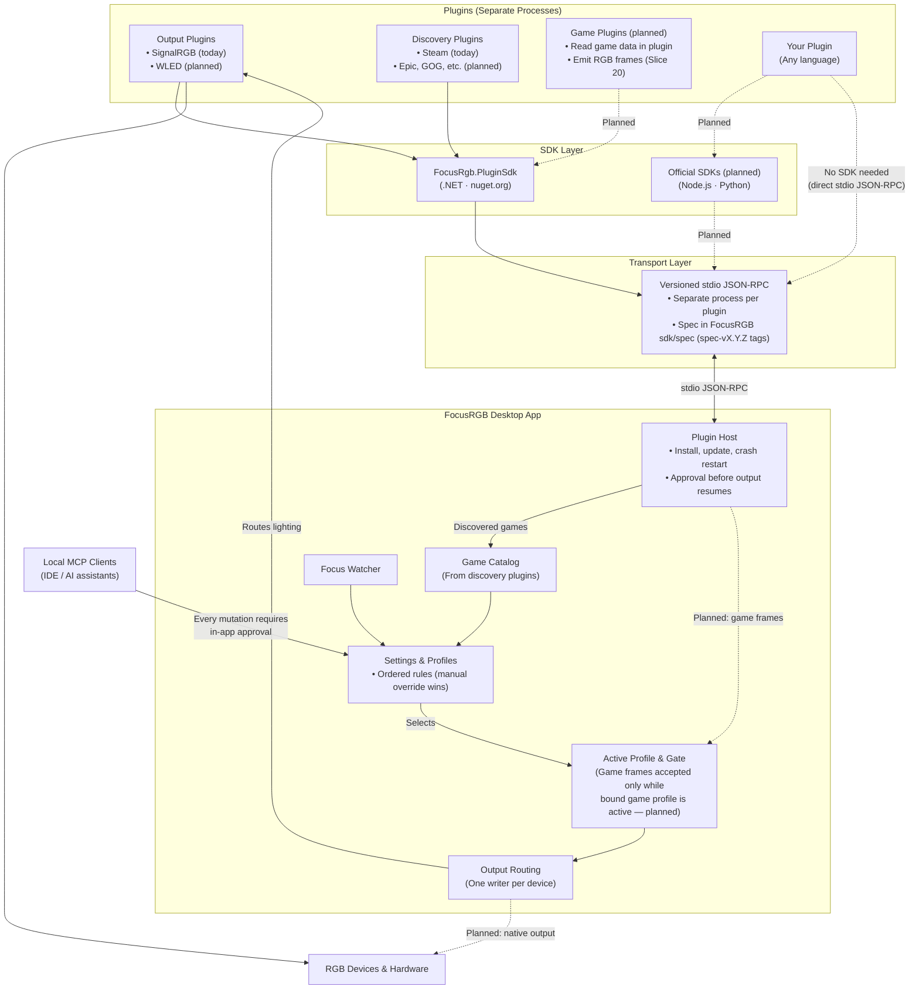

# FocusRGB

**Lighting that follows what you're doing.** FocusRGB is an open-source desktop RGB controller.
It switches lighting profiles automatically depending on the app or game in focus, and it is
built around plugins.

> 🚧 **Early development.** No release is published yet. Follow the [roadmap](https://github.com/orgs/FocusRGB/projects/1)
> for progress.

> **User guides:** Visit the [FocusRGB Wiki](https://github.com/FocusRGB/FocusRGB/wiki) for plugin installation and the SignalRGB setup guide.

## Repositories

| Repository | What it is |
|---|---|
| [**FocusRGB**](https://github.com/FocusRGB/FocusRGB) | The desktop app (.NET 10 and Avalonia), the portable core, the plugin host and the protocol spec |
| [**FocusRGB-Plugin-SDK**](https://github.com/FocusRGB/FocusRGB-Plugin-SDK) | Official plugin SDKs: .NET (`FocusRgb.PluginSdk` on nuget.org), with Node and Python planned |
| [**FocusRGB-Plugin-SignalRGB**](https://github.com/FocusRGB/FocusRGB-Plugin-SignalRGB) | Official plugin that lets SignalRGB render FocusRGB profiles |
| [**FocusRGB-Plugin-Steam**](https://github.com/FocusRGB/FocusRGB-Plugin-Steam) | Official discovery plugin that scans installed Steam games and launch executables |

## How it works

- **Plugins:** output, discovery, and integrations run as separate processes communicating over
  versioned stdio JSON-RPC. Remove a plugin and the app keeps working.
- **Profiles:** each profile has one effect and one layout. The app chooses a profile manually,
  or automatically from an ordered list of application groups. The top matching rule wins.
- **Game frames (planned):** game integration plugins read game data in the plugin and emit direct
  RGB frames; the host accepts those frames only while the bound game profile is active, routing them to output.
- **Local MCP:** local Model Context Protocol clients (IDEs and AI assistants) can query state and
  request profile mutations, with every mutation requiring explicit, single-use user approval in the app.
- **Windows first:** the core is portable, so other platforms can follow.

## Contributing

- **Bugs and ideas:** open an issue in the [main repository](https://github.com/FocusRGB/FocusRGB/issues).
- **Writing a plugin:** plugins communicate with the host over versioned stdio JSON-RPC. The protocol contract is normatively documented in [`sdk/spec/`](https://github.com/FocusRGB/FocusRGB/tree/spec-v1.2.0/sdk/spec) and can be implemented in any language. .NET developers can use [`FocusRgb.PluginSdk`](https://www.nuget.org/packages/FocusRgb.PluginSdk) on nuget.org; official Node and Python SDKs are planned. Protocol changes start in `FocusRGB/sdk/spec/`, get tagged (`spec-vX.Y.Z`), and only then reach SDKs and plugins.
- **Official plugins** are repositories in this organization that carry the
  `focusrgb-plugin` topic.

FocusRGB is developed and maintained by **Devantix**.
Licensed under MIT.
